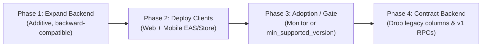

# Zero-Downtime Deployments & Breaking Changes

Because **`scoreboard-mobile`** users do not update instantaneously (App Store / Google Play review times plus users remaining on older app versions for days or weeks), breaking changes across **`scoreboard-backend`**, **`scoreboard-web`**, and **`scoreboard-mobile`** must **never** be deployed as a simultaneous cutover.

All breaking schema, RPC, Edge Function, and Realtime payload changes must follow the **Expand-and-Contract (Parallel Change)** workflow.

---

## The 4-Phase Rollout

### Phase 1 — Expand the Backend (100% Backward-Compatible)
Deploy database and API changes **first**, keeping every existing client contract working:
- **PostgreSQL migrations:**
  - Add new tables, nullable columns (or columns with safe defaults), and new RPCs.
  - **Never** `DROP`, `RENAME`, or alter the type of an existing column, view field, or RPC parameter in the same release that updates client code.
  - Avoid table locks: create indexes with `CONCURRENTLY` outside transaction blocks and backfill large tables in small batches.
- **Dual-support / Backfill:**
  - When replacing or reshaping a field, keep the old and new fields in sync (via triggers, views, or RPC logic) while backfilling existing rows.
- **Edge Functions & Realtime Broadcast:**
  - Add new keys alongside existing keys or introduce a versioned RPC/channel (`v2`) rather than mutating an active payload shape in place.

### Phase 2 — Roll Out Clients (`scoreboard-web` & `scoreboard-mobile`)
Once Phase 1 is live in production:
- **Web (`scoreboard-web`):** Deploy immediately. Optionally gate risky UI flows behind a feature flag so you can verify in production before enabling for all users.
- **Mobile (`scoreboard-mobile`):**
  - **JS/UI-only changes** (same native dependencies and Expo `runtimeVersion`): ship via **EAS Update** (OTA) so users receive the update on next launch.
  - **Native or contract-breaking changes:** submit a new build to App Store / Google Play.
- During this window, updated Web/Mobile clients use the new contract while older Mobile installs continue working against the Phase 1 compatibility layer.

### Phase 3 — Wait for Adoption (or Gate Old Mobile Builds)
- Monitor store adoption and API/RPC logs until traffic from legacy mobile versions drops off.
- If a legacy client must be retired before cleanup, enforce a `min_supported_version` check in Supabase / Remote Config (checked on app launch) **only after** the replacement build is already live in both stores.

### Phase 4 — Contract (Cleanup)
Once legacy clients are gone (or blocked by `min_supported_version`):
1. Remove dual-write triggers, legacy RPC overloads, and fallback branches.
2. Drop deprecated columns/tables in a dedicated follow-up migration.

---

## Rollback Safety
- Keep Phase 2 reversible: if `scoreboard-web` or `scoreboard-mobile` hits a regression, you can roll back the client immediately because the backend still supports the previous contract until Phase 4.
