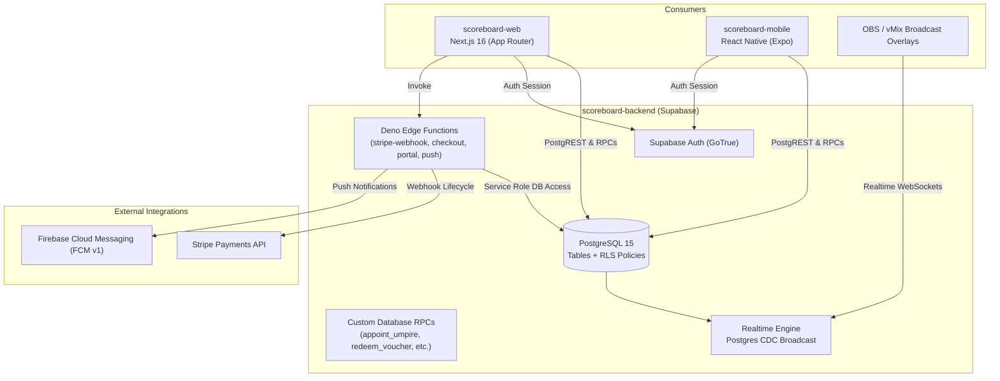

# ScoreBoard Backend — Technical Wiki & Database Architecture

Welcome to the technical knowledge base for **`scoreboard-backend`**, the Supabase data and services foundation for the ScoreBoard ecosystem (PostgreSQL 15, Row Level Security, Deno Edge Functions, Realtime replication, and Stripe/FCM webhooks).



---

## 📚 Backend Wiki Index

| Document | Topic | Description |
| :--- | :--- | :--- |
| **[`00-database-schema.md`](file:///Users/goncaloforte/Sandbox/ScoreBoard/scoreboard-backend/docs/00-database-schema.md)** | **Database & RLS Layer** | PostgreSQL schema, tables (`users`, `matches`, `tournaments`, `subscriptions`, `vouchers`), RLS policies, custom RPCs, and Mermaid ERD. |
| **[`01-edge-functions.md`](file:///Users/goncaloforte/Sandbox/ScoreBoard/scoreboard-backend/docs/01-edge-functions.md)** | **Deno Edge Functions** | Edge functions catalog (`stripe-webhook`, `create-checkout-session`, `create-portal-session`, `fcm-push`), Supabase Realtime channels. |
| **[`02-database-rpcs-and-scoring.md`](file:///Users/goncaloforte/Sandbox/ScoreBoard/scoreboard-backend/docs/02-database-rpcs-and-scoring.md)** | **Database RPCs & Sport Engine** | Stored procedures (`appoint_match_umpire`, `redeem_voucher`), state machines, and scoring constraints across supported sports. |
| **[`03-subscriptions-and-gdpr.md`](file:///Users/goncaloforte/Sandbox/ScoreBoard/scoreboard-backend/docs/03-subscriptions-and-gdpr.md)** | **Billing, Vouchers & GDPR** | Stripe tier mappings (€3.99/mo, €34.99/yr), beta voucher redemption engine, and GDPR Article 17 user deletion procedures. |

---

## 🛠️ Repository Layout

```text
scoreboard-backend/
├── docs/                        # Backend technical wiki
├── supabase/
│   ├── config.toml              # Supabase CLI project configuration
│   ├── functions/               # Deno Edge Functions
│   │   ├── create-checkout-session/
│   │   ├── create-portal-session/
│   │   ├── fcm-push/
│   │   └── stripe-webhook/
│   └── migrations/              # Version-controlled PostgreSQL migrations
└── .agents/                     # AI Agent configuration
    ├── rules/docs-sync.md       # Backend documentation synchronization rule
    └── skills/living-docs/      # Living Docs skill
```
